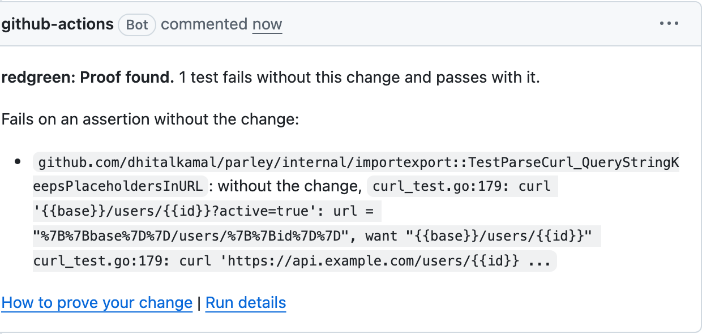

# redgreen

Red without the change, green with it.

Coding agents now open a lot of pull requests, and most of them come with tests. Green tests show the code runs. They do not show that the tests check the change: a test written next to a fix, by an agent or a person, often passes on the old code too.

redgreen is a GitHub Action for maintainers that checks this on every pull request. The tests the pull request adds or changes should fail on the code before the change and pass with it. It posts one comment, one check, and one label per pull request.

It runs in your repository's own GitHub Actions minutes. There is no service, no account, and no AI: the verdict comes from running your tests, not from a model.

A real result on [dhitalkamal/parley#18](https://github.com/dhitalkamal/parley/pull/18): the new test fails on the old code because a `{{var}}` placeholder came back percent-encoded, and passes with the fix.

## How it works

- Stage 1, `check`, runs in a read-only `pull_request` job after your usual setup steps. It runs your tests with the change, puts the non-test files back to the base branch, runs the tests again, restores everything, and compares the two runs test by test using JUnit XML.
- Stage 2, `report`, runs from your default branch with permission to comment. It never runs pull request code. It validates the results, confirms they came from the right run, and publishes. Results are rejected, with a neutral "results rejected" check, when they are stale (the pull request head moved on after the run) or when the head repository is unknown (for example a deleted fork).

## Quick start

Add `docs/templates/redgreen.yml` and `docs/templates/redgreen-report.yml` to `.github/workflows/`. In the first file, replace the setup steps and `test-command` with your project's own. Stage 1 uses `dhitalkamal/redgreen@v1` and stage 2 uses `dhitalkamal/redgreen/report@v1`.

## Verdicts

| Verdict | Meaning |
|---|---|
| Proof found | At least one test fails without the change and passes with it |
| No proof | No test fails without the pull request's code changes and passes with them |
| No proof yet | The pull request adds or changes no tests |
| Breaks tests | Tests that passed before fail with the change |
| Inconclusive | No clean comparison was possible; the comment says why |
| Unverified | The pull request changes CI or test configuration, so the result cannot be trusted |

## check inputs

| Input | Default | Purpose |
|---|---|---|
| `test-command` | required | Command that runs the tests |
| `junit-path` | none | Glob for JUnit XML files; enables per-test results |
| `install-command` | none | Reinstalls dependencies when a pull request changes them |
| `test-patterns` | built-in | Replaces the test file patterns |
| `extra-test-patterns` | none | Adds to the test file patterns |
| `dependency-patterns` | built-in | Replaces the dependency file patterns |
| `run-timeout-minutes` | 20 | Time limit for each test run |
| `retries` | 0 | Extra repeats of each run to detect flaky tests |
| `run-without-test-changes` | false | Run even when no test files changed |
| `max-changed-files` | 3000 | Above this, the result is inconclusive |

## Test command setup

These setups were checked against merged bug-fix pull requests in real projects. Use the test tool versions your project already pins.

- pytest: `test-command: pytest --junitxml=junit.xml`, `junit-path: junit.xml`.
- Vitest: `test-command: npx vitest run --reporter=junit --outputFile=junit.xml`, `junit-path: junit.xml`.
- Jest: install the reporter in a setup step with `npm install --no-save jest-junit` (repeat it in `install-command` if you set one). Then `test-command: JEST_JUNIT_REPORT_TEST_SUITE_ERRORS=true JEST_JUNIT_ADD_FILE_ATTRIBUTE=true JEST_JUNIT_OUTPUT_FILE=junit.xml npx jest --ci --reporters=default --reporters=jest-junit`, `junit-path: junit.xml`. Both options matter: without the first, a test file that cannot load leaves nothing in the XML; without the second, its tests cannot be matched to that file, so a new module plus its tests ends up inconclusive instead of proof. Keep any environment your CI sets for tests, such as `TZ`.
- node:test (Node 20 or newer): `test-command: node --test --test-reporter=junit --test-reporter-destination=junit.xml`, `junit-path: junit.xml`.
- Go: install gotestsum in a setup step with `go install gotest.tools/gotestsum@v1.12.3`. Then `test-command: gotestsum --junitfile junit.xml -- ./...`, `junit-path: junit.xml`. A package that does not compile without the change counts as missing-code proof when the pull request changed a test file in that package.
- Rust: use cargo-nextest with a config file that contains `[profile.default.junit]` and `path = "junit.xml"`. Then `test-command: cargo nextest run --no-fail-fast`, `junit-path: target/nextest/default/junit.xml`. Without `--no-fail-fast`, nextest stops at the first failure and the remaining tests cannot be compared. Test targets with `harness = false` need an explicit `--test <name>`. Doctests are not run. When the tests do not compile without the change, nextest writes no XML and redgreen falls back to comparing the whole command.

## report inputs

| Input | Default | Purpose |
|---|---|---|
| `github-token` | the workflow token | Reads the artifact and writes the comment, check and label |
| `check-workflow` | `.github/workflows/redgreen.yml` | The stage 1 workflow that must have produced the results |
| `mode` | advisory | `advisory` never fails the check; `blocking` fails it for results in `block-on` |
| `block-on` | no-proof, breaks-tests | Results that fail the check in blocking mode |
| `labels` | true | Apply proof labels |
| `label-prefix` | `proof: ` | Label prefix |
| `comment` | true | Post the pull request comment |
| `skip-authors` | Dependabot, Renovate, GitHub Actions | Authors to skip |
| `skip-drafts` | false | Skip draft pull requests |
| `trust-patterns` | built-in | Paths that make results unverified when a pull request changes them |
| `guide-url` | this repo's guide | Link to the contributor guide |

## What redgreen can and cannot tell you

- Proof means the tests depend on the change. It does not mean the change is correct or wanted.
- Stage 1 runs pull request code, so a determined attacker could forge its results. redgreen marks pull requests that change workflows or test configuration as unverified. Treat proof as evidence for review, never as permission to merge.
- Tests inside source files, such as Rust inline tests, cannot count as proof yet.
- Pull requests that change dependencies need `install-command`. It also runs on the code without the change, so it has to work on the base branch; a pull request that adds the dependency manifest itself (for example a first `package.json`) comes back inconclusive.
- Pull requests from forks get no secrets, so tests that need secrets are ignored.
- Test time doubles for pull requests that change tests.

## License

Apache-2.0. See LICENSE.
